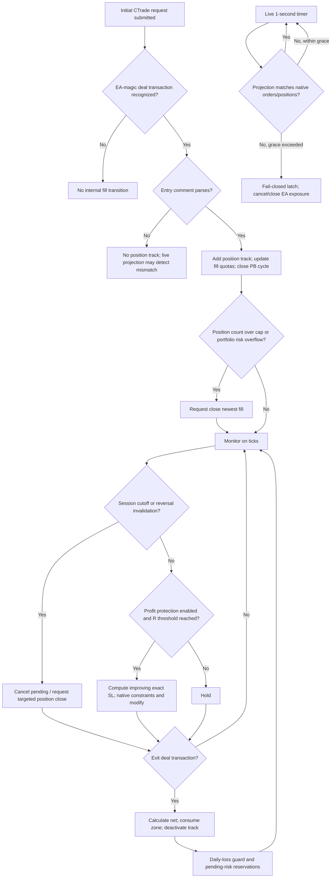

# Order and Position Management

This document starts at initial order submission and covers the subsequent order, deal, and position lifecycle implemented by the MQL5 EA. The preceding decision stages are [Ticks and Zones to Signals](TICKs_and_ZONEs_to_SIGNALs.md) and [Signals to Orders](SIGNALs_to_ORDERS.md).

The strategy source is `mt5/MQL5/Experts/XAUUSD_ROBUST_FINAL_LIVE_RCv2.mq5`; live-release callbacks and guards are included from `mt5/MQL5/Experts/XauRobustLiveEnvelope.mqh`.

## Purpose and scope

The EA tags its own requests with magic number `260911125` and a comment containing type, broker day, zone, and side. Recognized deal transactions create internal position tracks; later ticks manage protection, session safety, and risk. MT5 and the broker determine actual placement, fills, partial fills, stop execution, and transaction delivery.

## Order and position lifecycle overview

The lifecycle is: submit initial CTrade request → receive native trade/deal transaction → match EA magic and request comment → create a position track for an entry deal → enforce post-fill position and portfolio caps → monitor pending cycles and open positions → modify protective SL or request session/invalidation closes → consume zone usage and update daily realized loss on exit deal. The EA considers a position closed for internal tracking when a recognized exit transaction for its position identifier is processed.

In the live release envelope, initialization requires the release preflight to pass. On each live tick and timer, runtime identity/permission/exposure guards run; the timer also compares native positions/orders with in-memory projections and latches fail-closed after the configured mismatch grace. Strategy Tester bypasses this live envelope.

## Order identification and tracking

- EA trade events are accepted only when the selected deal’s `DEAL_MAGIC` equals `EA_MAGIC`; unrelated deals are ignored.
- Position management scans/filter positions by the same magic. Pending cycle orders are tracked by their order ticket. Session safety also filters positions/orders by magic.
- Request comments encode `R` reversal, `P` pullback, or `B` direct breakout, plus day, zone ID and side. Transaction processing reads the deal comment and falls back to the originating order comment when needed; `ParseComment` must succeed before it adds an entry track.
- `RequestMeta` links a submitted comment with requested entry, SL, TP, R0, target zone, breakout lineage, and reversal ordinal. On recognized entry fill it is looked up and deactivated; if missing, tracked values default to zero/empty, though type/day/zone/side still come from the comment.
- `PositionTrack` is keyed by `DEAL_POSITION_ID`; its ticket is resolved from current MT5 positions. `risk_anchor_entry` is the requested quote stored before submission, while `actual_fill` is the deal price; R-stage progress uses the requested anchor and stage-1 break-even uses actual fill. Duplicate position IDs are not added twice. Pullback fills close the matching active cycle. Reversal and pullback zone-fill counters increment on track creation, i.e. recognized entry transaction.
- Live projection reconciliation checks that every EA-magic native position has an internal track and every EA-magic native order maps to an active pullback cycle, and that counts match. A mismatch after the grace count triggers fail-closed handling.

## Execution events and state transitions

`ApprovedStrategyOnTradeTransaction` handles only `TRADE_TRANSACTION_DEAL_ADD` with a nonzero deal that can be selected and has EA magic. For entry (`DEAL_ENTRY_IN` or `INOUT`), it parses identity, records request metadata if found, creates a position track, logs fill/cost telemetry, checks the position cap and portfolio budget, and tags overlapping same-zone/same-direction pullback positions.

For exit (`DEAL_ENTRY_OUT`, `OUT_BY`, or `INOUT`), it calculates net result from position history by summing profit, commission, swap, and fee for EA-magic deals. It updates daily net realized and accumulated gross losses, marks zone usage consumed, deactivates the track, applies daily-loss guard, then enforces pending risk reservations. `INOUT` can enter both branches in the same callback, consistent with its enum handling. Any recognized exit event deactivates the track; the source does not check whether an exit deal is partial before doing so.

The position-cap overflow path attempts to close the newest recognized fill when EA-magic open position count exceeds `InpMaxLivePositions`. Post-fill portfolio overflow similarly attempts to close that fill if used risk exceeds budget by more than `$0.05`. These are close requests, not proof the broker completed a close.

## Position monitoring and risk controls

### Portfolio reservation

When portfolio risk is enabled, the budget is a percentage of initial balance, or QA strategy capital in discovery mode. Current used risk is realized daily loss (gross losses or net loss according to mode) + EA open cash risk to current SL + EA pending cash risk to pending SL. If an open position has no current SL, its tracked initial SL is used. Risk is estimated with native `OrderCalcProfit`; calculation failure makes a new-entry snapshot fail closed. New entries reserve enough remaining budget for their own stop risk. Post-fill overflow can trigger a close. Following exits or other specified lifecycle events, pending pullback orders are canceled from the newest active-cycle end until reservations are back under budget or a cancellation/snapshot failure occurs.

### Daily loss guard

The guard uses daily net realized loss and a capital basis. By default it applies only when initial capital is below `$300`, with a `20%` threshold. `InpTestDailyLossOverride` forces a configured percentage in `(0,100)` regardless of the `$300` baseline cutoff. In QA discovery mode the threshold can be calculated against `InpQAStrategyCapitalBasis`, but the guard only logs “would trigger” and does not stop signal entries. Outside that QA bypass, reaching or crossing the negative threshold sets `g_daily_stop` and cancels pullback cycles/pending requests. On a new broker day, daily realized counters and the stop flag reset; open positions remain managed.

## Stop-loss, take-profit, break-even, and trailing logic

Initial SL/TP are set in the entry request. Profit protection runs on each strategy tick when `InpEnableProfitProtection` is true and an active track has positive R0. Progress is measured from `risk_anchor_entry` using executable Bid for buys and Ask for sells, floored at zero:

| Stage threshold | Desired stop rule |
|---|---|
| Favorable move >= 1.0 R0 | Break-even at actual fill, adjusted to cover known negative native commissions, swaps, and fees converted to price distance with `OrderCalcProfit` |
| Favorable move >= 1.5 R0 | Lock `+0.5 R0` from risk anchor |
| Favorable move >= 2.0 R0 | Trail to latest confirmed higher low for buy or lower high for sell, if it improves the current stop; otherwise use the `+0.5R` lock |

Stages only increase. Structural pivots use bars 2 through at most 100 (as available), strict one-left/one-right local extrema, and require the latest buy pivot above the prior pivot (or latest sell pivot below the prior pivot). No qualifying structure leaves stage 2’s fixed `+0.5R` stop in use.

`ModifyStopExact` normalizes the desired level to `_Digits`, requires it to improve the current SL (buy: higher by more than `0.1 * _Point`; sell: lower by more than that), and requires the exact price to satisfy current `SYMBOL_TRADE_STOPS_LEVEL` relative to Bid/Ask. It preserves current TP. Invalid exact levels or rejected modification calls are retried on later ticks; there is no arbitrary buffer. A no-change server retcode is treated as success. The broker may still execute existing SL/TP independently of the EA’s management callback.

## Position modification and closure rules

- A confirmed buffered breakout closes active reversal positions in the same zone whose direction is opposite to the breakout before attempting direct-breakout entry or creating a pullback cycle. A failed close request stops those later actions for that zone in the current closed-bar processing.
- Pullback cycle expiry or invalidation deletes its associated native pending order when selectable, then deactivates the cycle. A disappeared pending order without recognized fill clears its ticket and can be retried while the cycle remains active.
- Daily-loss and session cutoff cancel pending pullback cycles/orders. Session safety can also close positions according to its configured mode.
- On session cutoff, `SESSION_ALL_FLAT` targets all EA positions and blocks both entry families; `SESSION_PB_FLAT` targets pullback positions and blocks pullback entries; `SESSION_BASELINE_CARRY` does not trigger flattening or session entry blocks. Cutoff begins `InpSessionPreCloseMinutes` before the containing broker session end (default 5), and flatten is retried every tick. A position is tagged as session-close requested before calling `PositionClose`; failure clears that request flag.
- The EA does not implement a general opposite-signal close rule. The documented opposite-signal exit is the breakout invalidation of same-zone reversal positions.
- Broker-side SL/TP execution closes a position outside of an EA-issued close request. The EA learns of the resulting exit through transaction events.

## Multiple positions, exposure restrictions, and conflicting conditions

EA-magic open positions are capped by `InpMaxLivePositions` (default 3), but multiple same-zone/direction pullback positions can stack if a later valid cycle fills while an older pullback position remains open. Pending orders are not included in the open-position count; portfolio risk separately includes their stop risk. Reversal per-zone limits count fills, with normal/high priority rules described in [Signals to Orders](SIGNALs_to_ORDERS.md).

The live envelope optionally rejects any manual/external position or pending order on the chart symbol during preflight and every runtime guard. It validates account login, server, chart symbol, hedging mode, release-mode/account-mode consistency, trade permissions, and real-money confirmation for live mode. Tester execution bypasses these release guards. Runtime failure latches the EA, sets restart lock, cancels pullback cycles, and repeatedly attempts deletion of EA orders and closure of EA positions. A red chart kill button invokes the same emergency-stop path.

The account must be hedging mode even outside the live envelope. `OnDeinit` invokes emergency stop for live exposure before removing the timer/control and deinitializing strategy code. This is a safety close attempt, not a platform guarantee of immediate flattening.

## Error handling, recovery, and exceptional cases

- Live startup fails closed if emergency stop is active, reconciliation grace is outside 1–60 seconds, account identity/mode/permissions mismatch, or configured external-XAU exposure is found. `InpReleaseMode=DISABLED` cannot pass live preflight; tester bypasses it.
- Live timer reconciliation compares native positions/orders to in-memory tracks/cycles. After the mismatch counter reaches `InpReconciliationGraceSeconds`, it latches fail-closed. A matching projection resets the counter.
- Strategy restart does not restore prior trend, zone quotas, daily counters, cycles, or position tracks. If same-day EA deal history or exposure exists, the strategy locks and attempts to close/delete native EA activity until the next broker day. `InpAllowSameDayFreshStart` bypasses that only when no EA position/order exists; it still starts in-memory state fresh.
- Native selection, history, tick, profit, session, and trade operations can fail. Explicit checked failures generally block entries, defer exact stop changes, log and retry pending placements, or latch live operation. The EA cannot guarantee broker completion from a successful local method return; it checks retcodes in its entry, modification, and close paths where implemented.
- Fill tracking uses transaction callbacks and in-memory metadata. A missing/unparseable comment prevents position-track creation; an accepted order can therefore exist before or without a recognized track, which the live projection guard can detect after its grace interval.
- If `HistorySelectByPosition` fails while calculating closed-position net, `CalculatePositionNet` returns `0.0`; that exit contributes no realized result to the daily-loss counters.
- No general partial-close accounting model is implemented. Exit-deal net is calculated from position history; the source comment describes the full-position net as suitable for the non-partial lifecycle. Partial entry retcodes are accepted, but repeated entry deals for an already tracked position ID do not add a second track.

## Decision tables and meaningful edge cases

| Event or state | Condition | EA action |
|---|---|---|
| Entry deal | `DEAL_ADD`, nonzero/selectable, EA magic, parseable comment | Create track from comment and saved metadata; update counters and risk checks |
| Exit deal | EA-magic `OUT`, `OUT_BY`, or `INOUT` for tracked position | Sum position net, consume zone usage, deactivate track, check daily and pending risk |
| Position count overflow | EA-magic open positions > configured cap | Attempt close of newest fill |
| Portfolio overflow after fill | Used risk > budget + `$0.05` | Attempt close of newest fill |
| Profit stage 1/2/3 | Favorable Bid/Ask movement reaches 1R/1.5R/2R | Cost-adjusted break-even / +0.5R lock / structural trail if improving |
| SL temporarily invalid by Stops Level | Exact desired SL fails current quote-distance test | Keep desired candidate and retry on later tick |
| Daily-loss threshold | Net realized <= negative configured threshold; QA discovery off | Set daily stop and cancel pullback cycles |
| Session preclose | Current time within configured cutoff before broker session end | Cancel pullbacks and flatten mode-targeted positions, retrying each tick |
| Native/internal projection mismatch | Persists for configured live timer grace | Latch fail-closed and attempt to close/delete EA exposure |
| Same-day restart with history/exposure | No allowed clean fresh start | Lock entries and attempt to close/delete EA exposure; do not restore state |
| Opposing buffered breakout | Active same-zone reversal positions exist | Request their closure first; failure prevents later direct BO/PB actions for that zone |

## Lifecycle and decision flowchart

## Source-code reference map

| Lifecycle rule | Implementation |
|---|---|
| Request identity and position tracking | `XAUUSD_ROBUST_FINAL_LIVE_RCv2.mq5`: `MakeComment` / `ParseComment` (1684/1691), `AddPositionTrack` (1814), `ApprovedStrategyOnTradeTransaction` (3343) |
| Position cap and restart handling | `CountEAOpenPositions` (1864), `MVPHasLiveSlot` (1884), `DetectSameDayRestartFailClosed` (1951), `MaintainRestartFailClosed` (1933) |
| Portfolio exposure and pending reservation | `PortfolioRiskSnapshot` (2236), `CheckPortfolioRiskAfterFill` (2337), `EnforcePendingRiskReservations` (2297) |
| Profit stages and exact SL movement | `ManageProfitProtection` (3194), `FindConfirmedStructureSL` (3077), `ModifyStopExact` (3143), `StopImproves` (3119), `CanModifyStopExact` (3130) |
| Daily loss and transaction accounting | `CalculatePositionNet` (3284), `CheckDailyLossGuard` (3304), `ApprovedStrategyOnTradeTransaction` (3343) |
| Pullback pending lifecycle | `EndCycle` (2726), `AgePullbackCyclesOnNewBar` (2743), `ManagePullbackCycles` (2860), `EnforcePendingRiskReservations` (2297) |
| Session cutoff and flattening | `GetContainingTradeSession` (724), `FlattenSessionPositions` (872), `ManageSessionSafety` (923) |
| Live envelope and callbacks | `XauRobustLiveEnvelope.mqh`: `XauReleasePreflight` (124), `XauReleaseRuntimeGuard` (171), `XauReleaseProjectionMatches` (195), `OnInit` (268), `OnDeinit` (284), `OnTick` (293), `OnTimer` (308), `OnTradeTransaction` (333) |

## Unresolved questions and verification gaps

- In-memory request metadata and position tracks are not rebuilt from native history on restart. Fail-closed cleanup is the implemented recovery; it does not preserve prior protective-stage or quota state.
- Session behavior depends on broker-provided `SymbolInfoSessionTrade` schedules. If no containing session is found, the preclose flag is cleared; the code does not impose a separate universal market-hours rule.
- Actual fills, partial-fill sequencing, server retcodes, SL/TP triggering, and close completion depend on MT5/broker execution. These documents describe EA requests and state updates, not guaranteed executions.
- The source does not implement general opposite-signal exits, configurable partial profit-taking, or a separate trailing-distance buffer. Such behavior should not be inferred from the presence of tracking fields or telemetry.
