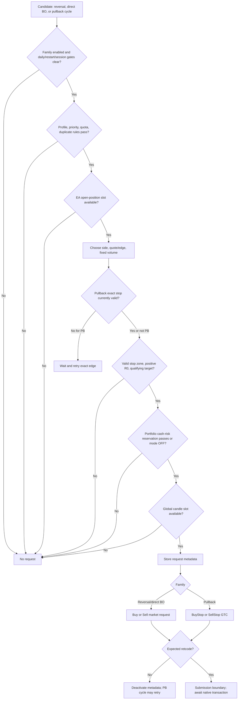

# سیگنال‌ها به سفارش‌ها (Farsi)

این سند از لمس معکوس، شکست تاییدشده، یا فرصت فعال پولبک آغاز می‌شود و تا فراخوانی اولیه سفارش `CTrade` EA ادامه می‌یابد. پردازش fill و مدیریت جاری پوشش داده نمی‌شود؛ به [مدیریت سفارش و پوزیشن](ORDER_and_POSITION_management.fa.md) مراجعه کنید. محاسبه سیگنال در [تیک‌ها و زون‌ها به سیگنال‌ها](TICKs_and_ZONEs_to_SIGNALs.fa.md) مستند شده است.

منبع حقیقت: `mt5/MQL5/Experts/XAUUSD_ROBUST_FINAL_LIVE_RCv2.mq5`.

## هدف و دامنه

EA یک لیست سیگنال عمومی مصرف نمی‌کند. شرایط سیگنال در متدهای استراتژی ارزیابی شده و در صورت اهلیت مستقیم به مسیر ورود مربوطه منتقل می‌شود. معکوس‌ها و شکست‌های مستقیم اختیاری سفارش بازار ثبت می‌کنند؛ پولبک‌ها منتظر penetration و اعتبار استاپ بومی می‌مانند سپس سفارش stop pending ثبت می‌کنند.

## جریان تصمیم سیگنال به سفارش

برای معکوس، `ProcessDirectionalReversalTouches` اسلات per-bar/zone/direction را claim کرده `SendReversal` را فرامی‌خواند. این متد قفل‌های entry و context را بررسی، سمت بازار و قیمت ورود را تعیین، سهمیه را اعمال، SL/TP را می‌سازد، رزرو پورتفو را بررسی، محدودیت اختیاری یک سفارش در هر کندل را اعمال و `trade.Buy` یا `trade.Sell` را صدا می‌زند.

برای شکست‌های مستقیم، `ProcessClosedBar` تنها وقتی `InpEnableDirectBreakout` true باشد `SendDirectBreakout` را فرامی‌خواند. گیت‌های روزانه/restart/session/priority/position/risk/slot اعمال، درخواست بازار ساخته و `trade.Buy`/`trade.Sell` فراخوانی می‌شود.

برای پولبک، `CreatePullbackCycle` فرصت را ثبت می‌کند اما هنوز درخواستی وجود ندارد. `ManagePullbackCycles` منتظر penetration پیکربندی شده می‌ماند و `PlaceConservativePending` zone، session، position، اعتبار دقیق edge، سطوح مبتنی بر R، ریسک پورتفو و اسلات اختیاری کندل را قبل از `trade.BuyStop`/`trade.SellStop` بررسی می‌کند.

## واجد شرایط بودن و اعتبارسنجی سیگنال

| ورود | کاندید و جهت | شرایط اصلی واجد بودن |
|---|---|---|
| معکوس (`R-B`/`R-S`) | لمس zone واجد trend-qualified؛ خرید با `Ask`، فروش با `Bid` | بدون قفل روزانه/restart؛ reversal فعال؛ گیت session روشن؛ گیت MVP/profile؛ اسلات position زنده؛ سهمیه مجاز fill per zone/day؛ استاپ مجاور معتبر و zone هدف حائز شرایط؛ ریسک پورتفو اگر فعال باشد؛ اسلات اختیاری کندل |
| پولبک (`PB-B`/`PB-S`) | cycle ایجادشده توسط شکست؛ buy stop در high zone، sell stop در low zone پس از penetration | pullback فعال و context مجاز در ایجاد و دوباره در مدیریت؛ بدون cycle تکراری day/zone/direction؛ cycle هنوز در پنجره bar؛ بدون daily stop یا session مسدود؛ اسلات position زنده؛ قیمت استاپ دقیق معتبر؛ استاپ/هدف معتبر R-based؛ ریسک پورتفو؛ اسلات اختیاری کندل |
| شکست مستقیم (`BO-B`/`BO-S`) | confirmed buffered close | فعال‌سازی explicit شکست مستقیم؛ بدون قفل daily/restart؛ گیت session reversal روشن؛ محدودیت اختیاری فقط zone عادی؛ اسلات position زنده؛ استاپ/هدف معتبر R-based؛ ریسک پورتفو؛ اسلات اختیاری کندل |

هر سه از `InpTestVolumeLot` به‌عنوان volume ثابت استفاده می‌کنند. مقداردهی اولیه مثبت بودن، مطابقت با min/max symbol، تراز به step volume، و سازگاری با PnL بومی موردانتظار برای move `$1` را وریفای می‌کند. Volume به‌طور خودکار برای margin یا risk کاهش نمی‌یابد.

## قوانین حالت داخلی و handle سیگنال

- اسلات touch معکوس قبل از بررسی اغلب restrictions `SendReversal` claim می‌شود، بنابراین معکوسی که توسط profile، quota، risk، وضعیت روزانه یا execution مسدود شود در همان bar M15 برای آن zone دومین تلاش same-direction نخواهد داشت.
- `g_restart_lock` ابتدا false است. در init، `DetectSameDayRestartFailClosed` در صورت هر deal history same-day EA-magic یا هر order/position زنده EA-magic آن را true می‌کند. `HasEADealToday` خطاهای time/history-selection را نیز evidence prior deal می‌داند. استثناء `InpAllowSameDayFreshStart=true` و بدون live EA order/position است.
- tick قفل‌شده restart `MaintainRestartFailClosed` را فراخوانی می‌کند که تلاش می‌کند تمام orderهای EA-magic را delete و تمام positionهای EA-magic را close کند، `g_prev_bid` را بروزرسانی و قبل از evaluation نرمال return می‌کند. قفل تا `HandleDayChange` در روز broker جدید باقی می‌ماند.
- در live mode، release envelope نیز از طریق `XauReleaseLatch` پس از emergency stop، failure account/permission/identity، external XAU exposure، kill-button یا emergency در deinit `g_restart_lock` را set می‌کند. Strategy Tester این guard release-envelope را bypass می‌کند.
- quota معکوس بر recognized fills (`reversal_fill_count`) استوار است نه touchها یا درخواست‌های submitted-but-unfilled. در explicit-controls mode، zone عادی یک fill اجازه می‌دهد مگر `InpReversalHighOnly` block کند؛ zone high تا `InpHighReversalMaxPerDay` fill. با controls disabled و MVP profile منتخب، معکوس فقط high-zone-only با quota profile-dependent است.
- quota پولبک نیز روی recognized fills افزایش می‌یابد. under explicit controls، zone عادی `InpNormalPullbackMaxPerDay` (0 block) و zone high `InpHighPullbackMaxPerDay` تنها وقتی positive (0 = unlimited). پیش‌فرض: normal 2، high 10.
- duplicate detection پولبک یک cycle فعال per day + zone + direction است. شکست دوم cycle موجود را تغییر نمی‌دهد. پس از ناپدید شدن pending order بدون recognized fill، cycle فعال ممکن است exact edge را retry کند.
- `InpOneNewOrderPerCandle` پیش‌فرض false است. اگر فعال شود، یک new request سراسری هر نوع entry ممکن است کندل را claim کند؛ slot قبل از CTrade claim و پس از failure request بازگردانده نمی‌شود.
- same-day restart detection در صورت وجود EA history یا live exposure entryها را lock می‌کند مگر `InpAllowSameDayFreshStart` فعال و EA position/order نباشد. routine fail-closed تلاش می‌کند EA orderها را delete و EA positionها را close کند؛ intentionally same-day quotas/trend state را reconstruct نمی‌کند.

## فیلترهای trading و محدودیت‌های تولید سفارش

### گیت‌های daily، session و position همزمان

`SendReversal` و `CreatePullbackCycle` وقتی `g_daily_stop` یا `g_restart_lock` فعال باشد reject می‌کنند. session cutoff از end broker-reported trade-session اندازه‌گیری می‌شود. `SESSION_ALL_FLAT` هر دو reversal و pullback را در پنجره pre-close (پیش‌فرض 5 دقیقه) block می‌کند؛ `SESSION_PB_FLAT` فقط pullback؛ `SESSION_BASELINE_CARRY` این blockها را غیرفعال می‌کند. direct breakout از گیت session reversal استفاده می‌کند.

`MVPHasLiveSlot` نیاز به `InpMaxLivePositions > 0` دارد و current EA-magic open positions را زیر cap (پیش‌فرض 3) می‌خواهد. pending orderها به‌عنوان open position count نمی‌شوند. counts بر magic number است. callback fill جداگانه newest position را close می‌کند اگر recognized fill باعث overflow cap شود.

### فیلترهای profile و zone-context

با `InpUseExplicitResearchControls=true` (پیش‌فرض)، reversal enable، high-only mode، high-zone free-space threshold، pullback allowed-by-priority، per-priority fill caps و pullback free-space threshold اعمال می‌شوند. directional free space = gap از outer edge zone فعلی به zone همسایه در جهت trade؛ در انتهای لیست zone مقدار `DBL_MAX`. مقایسه‌ها بلوک می‌کنند فقط وقتی free space strictly کمتر از threshold باشد، پس equality pass می‌کند.

اگر explicit controls disabled، MVP profile می‌تواند high-only، pullback-only، `$15` free-space و H2 reversal quota gate اضافه کند. پیش‌فرض فعلی explicit controls را انتخاب می‌کند بنابراین fallback MVP پیش‌فرض inactive است.

### رزرو ریسک نقدی پورتفو

وقتی risk mode on است، budget = `capital_basis * InpPortfolioRiskBudgetPercent / 100`؛ capital basis = initial account balance، یا `InpQAStrategyCapitalBasis` در QA discovery. risk used = realized component + current EA open cash risk + current EA pending cash risk. `GROSS_DAILY` accumulated gross realized losses؛ `NET_DAILY` = `max(0, -daily_realized_net)`. new risk با `OrderCalcProfit` از requested entry تا initial SL at fixed volume محاسبه می‌شود. pass فقط وقتی remaining budget حداقل `-$0.01` و new risk حداکثر remaining + `$0.01`. budget invalid، missing SL/price/volume، یا native calculation failure درخواست را block می‌کند. `OFF` check را skip می‌کند.

Margin precheck تنها telemetry است: `LogMarginPrecheck` `OrderCalcMargin` را صدا می‌زند و نتیجه را record می‌کند اما reject نمی‌کند. نتیجه native `CTrade` هنوز ممکن است برای insufficient margin یا سایر constraints platform/broker reject شود.

## تصمیم‌های Buy/Sell/No-trade

- `R-B`: `trade.Buy`؛ quote فعلی Ask. `R-S`: `trade.Sell`؛ quote فعلی Bid.
- `BO-B`/`BO-S` وققتی direct breakout فعال: market Buy/لpecific terminal price (`price=0.0`)، بعد از calculations بر اساس Ask/Bid sampled. `InpBreakoutNormalOnly` پیش‌فرض true و direct entries از high-priority zones را block می‌کند.
- `PB-B`: `BuyStop` دقیقاً در high normalized broken-zone. `PB-S`: `SellStop` دقیقاً در low normalized broken-zone. هر دو `ORDER_TIME_GTC`.
- هیچ trade وقتی هر candidate یا order gate بالادست fail شود، risk geometry unavailable، request eligibility false یا API trade reject شود. شکست همچنان می‌تواند cycle پولبک بسازد حتی اگر direct breakout disabled باشد؛ candidate event خود یک order نیست.

## تعیین پارامترهای اولیه سفارش

### جهت، نوع، volume و entry

جهت market از flag `buy` candidate پیروی می‌کند. volume = `InpTestVolumeLot`؛ آرگومان قیمت CTrade = `0.0`، پس MT5 قیمت execution بازار را انتخاب می‌کند. requested Ask/Bid برای risk geometry و metadata tracking استفاده می‌شود. جهت پولبک از cycle پیروی می‌کند و نوع order همیشه stop، نه limit؛ exact zone edge قیمت trigger requested است.

### Stop-loss، target و R0

Normal R geometry در `CalculateRBasedSLTP`:

- Buy: adjacent lower zone باید وجود داشته باشد. `SL = max(lower_zone.high, entry - InpRCapUSD)`. `R0 = entry - SL` باید positive باشد. TP = اولین zone بالاتر که low آن `zone.low - entry >= InpTargetR0Multiplier * R0`؛ TP low آن zone.
- Sell: adjacent upper zone باید وجود داشته باشد. `SL = min(upper_zone.low, entry + InpRCapUSD)`. `R0 = SL - entry` باید positive باشد. TP = اولین zone پایین‌تر که high آن `entry - zone.high >= InpTargetR0Multiplier * R0`؛ TP high آن zone.
- SL و TP به `_Digits` نرمالیزه می‌شوند؛ R0 دوباره از SL نرمالیزه recomputed می‌شود. پیش‌فرض `InpRCapUSD=6.0`, `InpTargetR0Multiplier=1.0`.
- معکوس high-zone از `CalculateExperimentalHighReversalSLTP` استفاده می‌کند: اول base stop distance همان را محاسبه، در `InpHighReversalSLMultiplier` (پیش‌فرض 1.5) ضرب برای expanded R0 و SL، سپس target zone حداقل `InpTargetR0Multiplier * expanded_R0` دورتر را require. direct-breakout و pullback از normal R geometry استفاده می‌کنند.
- missing adjacent stop zone، non-positive R0، یا no qualifying target zone opportunity را قبل از order construction reject می‌کند. هیچ fallback TP استفاده نمی‌شود.

## ساخت order-request و اعتبارسنجی پیش از submit

EA یک comment compact با encoding type (`R`,`P`,`B`)، broker day، zone ID و direction می‌سازد. request metadata (requested price, SL, TP, R0, target zone, parent breakout ID، reversal ordinal) را قبل از submit ذخیره می‌کند. Magic number `260911125` و filling mode در init انتخاب می‌شود.

بلافاصله قبل از pullback request، `CanPlaceExactStop` نیاز به tick بومی تازه و exact edge price beyond Ask/Bid مربوطه به‌میزان حداقل `SYMBOL_TRADE_STOPS_LEVEL * _Point` دارد. اگر invalid، wait و retry بدون move edge. portfolio risk و global candle slot قبل از metadata و request creation بررسی می‌شوند.

Calls submit اولیه:

| Candidate | CTrade call | retcodeهای success موردانتظار |
|---|---|---|
| Reversal buy/sell | `trade.Buy` / `trade.Sell` | `DONE` یا `DONE_PARTIAL` |
| Direct breakout buy/sell | `trade.Buy` / `trade.Sell` | `DONE` یا `DONE_PARTIAL` |
| Pullback buy/sell | `trade.BuyStop` / `trade.SellStop` with GTC | `PLACED` یا `DONE` |

boolean returned به‌تنهایی کافی نیست: code همچنین retcode result را بررسی می‌کند. failure metadata را deactivate می‌کند. placement pending failure cycle را برای retry later eligible می‌گذارد؛ failed market request retry queue ندارد. API result موفق به معنی accepted/placed مطابق retcode checked است نه حتماً deal/position موجود؛ fill recognition در سند سوم است.

## جداول تصمیم و edge caseهای معنی‌دار

| Rule | شرط implemented | نتیجه |
|---|---|---|
| Entry lock | Daily stop، restart lock، family disabled، session blocked | No new request |
| Position cap | EA-magic open position count زیر `InpMaxLivePositions` نیست | No request؛ pending orders از count مستثنی |
| Reversal quota | filled reversal count به allowance رسید | No request؛ QA discovery ممکن است فقط shadow candidate emit کند |
| Pullback free space | `free_space < threshold` | Reject cycle؛ equality passes |
| R geometry | adjacent stop zone absent، R0 <= 0، یا target fails distance test | Reject؛ no substitute levels |
| Portfolio reservation | `remaining < -0.01` یا `new_risk > remaining + 0.01` | Reject؛ invalid native-risk calculation هم reject |
| Exact pending price | Stop edge beyond current quote by Stops Level نیست | Wait؛ retry exact edge on later tick |
| Duplicate pullback cycle | Active day + zone + direction cycle exists | Keep prior cycle؛ do not restart |
| Market API | False return یا retcode outside DONE/DONE_PARTIAL | Reject and deactivate request metadata |
| Pending API | False return یا retcode outside PLACED/DONE | Retain cycle for retry، no pending ticket recorded |
| Margin telemetry | `OrderCalcMargin` returns false یا low free margin | Log only؛ actual request result controls acceptance |

## فلوچارت تصمیم trading



## نقشه reference کد منبع

| Decision | Implementation |
|---|---|
| Reversal eligibility, risk checks, market request | `XAUUSD_ROBUST_FINAL_LIVE_RCv2.mq5`: `SendReversal` (2548), `ProcessDirectionalReversalTouches` (2650) |
| Profile/quota/free-space rules | `MVPDirectionalFreeSpace` (1973), `MVPPullbackAllowed` (1988), `MVPReversalAllowed` (2056), `AllowedReversalCountForZone` (2393) |
| R-based initial levels | `CalculateRBasedSLTP` (1567), `CalculateExperimentalHighReversalSLTP` (2420) |
| Portfolio reservation | `PortfolioRiskEvaluateNew` (2265), `PortfolioRiskSnapshot` (2236), `NativeCashRisk` (2153) |
| Pullback cycle and pending placement | `CreatePullbackCycle` (2691), `ManagePullbackCycles` (2860), `CanPlaceExactStop` (2757), `PlaceConservativePending` (2770) |
| Direct breakout request | `SendDirectBreakout` (2957), `ProcessClosedBar` (3003) |
| Entry cap and once-per-bar slot | `MVPHasLiveSlot` (1879), `ClaimGlobalEntrySlot` (1884) |
| Session entry restrictions | `SessionBlocksPullbackEntries` (786), `SessionBlocksReversalEntries` (791), `ManageSessionSafety` (923) |
| Restart and live fail-closed lock | `HasEAOrderOrPosition` (1896), `HasEADealToday` (1913), `DetectSameDayRestartFailClosed` (1951), `MaintainRestartFailClosed` (1933), `HandleDayChange` (3448), `ApprovedStrategyOnTick` (3615); `XauRobustLiveEnvelope.mqh`: `XauReleaseLatch` (154), `XauReleaseEmergencyStop` (164), `XauReleaseRuntimeGuard` (171) |
| Initialization parameter/account checks | `ApprovedStrategyOnInit` (3502), `ValidateVolumeCompatibility` (1163), `ValidateAccountMode` (1149) |

## پرسش‌های باز و شکافهای تأیید

- source برای hedging account تنظیم شده و account mode غیر-hedging را explicitly reject می‌کند. رفتار دقیق trade-server، accepted filling، و actual deal price همچنان outcome terminal/broker است.
- `LogMarginPrecheck` اطلاعاتی است و تضمین margin acceptance نیست؛ هیچ lot sizing خودکار به risk percentage یا free-margin level پیاده‌سازی نشده است.
- وقتی state in-memory در same-day restart از بین می‌رود، از fail-closed handling به‌جای restore quotas/cycles استفاده می‌کند. live recovery به state actual order/position MT5 و موفقیت fail-closed calls بستگی دارد.
- comments برخی pathها را research/experimental معرفی می‌کنند. input defaults تنظیمات منتخب را توصیف می‌کنند اما prove نمی‌کنند که یک run particular از آن defaults استفاده کرده یا strategy profitable/live-ready است.

(End of file - total 167 lines)
```
filePath">
C:\Code\XAAUSD-PA-sidecar-3\docs\SIGNALs_to_ORDERS.fa.md
