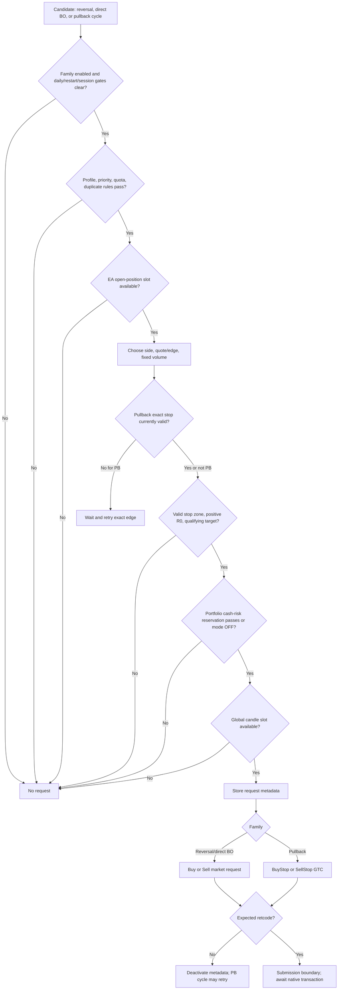

# Signals to Orders

This document starts with a reversal touch, confirmed breakout, or active pullback opportunity and ends at the EA’s initial `CTrade` order call. It does not cover fill processing or ongoing management; see [Order and Position Management](ORDER_and_POSITION_management.md). Signal calculation is documented in [Ticks and Zones to Signals](TICKs_and_ZONEs_to_SIGNALs.md).

The source of truth is `mt5/MQL5/Experts/XAUUSD_ROBUST_FINAL_LIVE_RCv2.mq5`.

## Purpose and scope

The EA does not consume a general signal list. Signal conditions are evaluated in the strategy methods and, when eligible, passed directly into the corresponding entry path. Reversals and optional direct breakouts submit market orders; pullbacks wait for penetration and native stop validity, then submit a pending stop order.

## Signal-to-order decision flow

For a reversal, `ProcessDirectionalReversalTouches` claims the per-bar/zone/direction slot and calls `SendReversal`. That method checks entry locks and context, determines the market side and entry price, enforces quota, constructs SL/TP, checks portfolio reservation and optional one-order-per-candle restriction, then calls `trade.Buy` or `trade.Sell`.

For direct breakouts, `ProcessClosedBar` calls `SendDirectBreakout` only when `InpEnableDirectBreakout` is true. It applies daily/restart/session/priority/position/risk/slot gates, creates a market request, and calls `trade.Buy` or `trade.Sell`.

For pullbacks, `CreatePullbackCycle` records the opportunity, but no request exists yet. `ManagePullbackCycles` waits for the configured penetration, and `PlaceConservativePending` checks zone, session, position, exact edge validity, R-based levels, portfolio risk, and optional candle slot before calling `trade.BuyStop` or `trade.SellStop`.

## Signal eligibility and validation

| Entry | Candidate and direction | Main eligibility conditions |
|---|---|---|
| Reversal (`R-B`/`R-S`) | Trend-qualified zone touch; buy uses `Ask`, sell uses `Bid` | No daily stop or restart lock; reversal enabled; reversal session gate clear; MVP/profile gate; live position slot; per-zone/day fill allowance; valid adjacent stop and qualifying target zone; portfolio risk allows if enabled; optional candle slot available |
| Pullback (`PB-B`/`PB-S`) | Breakout-created cycle; buy stop at zone high, sell stop at zone low after penetration | Pullback enabled and context permitted at creation and again during management; no duplicate active day/zone/direction cycle; cycle still within its bar window; no daily stop or blocking session; live position slot; exact stop price currently valid; valid R-based stop/target; portfolio risk allows; optional candle slot available |
| Direct breakout (`BO-B`/`BO-S`) | Confirmed buffered close | Explicit direct-breakout enable; no daily stop/restart lock; reversal-entry session gate clear; optional normal-zone-only restriction; live position slot; valid R-based stop/target; portfolio risk allows; optional candle slot available |

All three use `InpTestVolumeLot` as a fixed volume. Initialization verifies it is positive, within symbol min/max, aligned to volume step, and compatible with the expected native PnL for a `$1` price move. Volume is not automatically reduced to fit margin or risk.

## Internal state and signal-handling rules

- The reversal touch slot is claimed before `SendReversal` checks most entry restrictions. Therefore a reversal blocked by profile, quota, risk, daily state, or execution does not get a second same-direction attempt in that M15 bar for that zone.
- `g_restart_lock` starts false. At initialization, `DetectSameDayRestartFailClosed` sets it true if the EA has any same-day EA-magic deal history or any EA-magic live order/position. `HasEADealToday` treats time/history-selection errors as evidence of a prior deal, so those errors also lock. The exception is `InpAllowSameDayFreshStart=true` with no live EA order or position: initialization accepts a fresh in-memory start even if earlier same-day deals exist; it does not restore the old quota, trend, or daily-loss state.
- A restart-locked tick calls `MaintainRestartFailClosed`, which attempts to delete every EA-magic order and close every EA-magic position, updates `g_prev_bid`, and returns before normal strategy evaluation. The lock remains until `HandleDayChange` sees a new broker day and clears it.
- In live mode, the included release envelope can also set `g_restart_lock` through `XauReleaseLatch` after an emergency stop, account/permission/identity failure, detected external XAU exposure, operator kill-button action, or emergency handling during deinitialization. The latch separately keeps `XauReleaseRuntimeGuard` false, so clearing `g_restart_lock` at day change does not resume a latched live EA; it requires reinitialization. Strategy Tester bypasses the release-envelope runtime guard.
- Reversal quota is based on recognized fills (`reversal_fill_count`), not touches or submitted-but-unfilled requests. In explicit-controls mode, a normal zone allows one fill unless `InpReversalHighOnly` blocks it; a high zone allows `InpHighReversalMaxPerDay` fills. With controls disabled and the selected non-control MVP profile, reversal is high-zone-only, with profile-dependent quota; `SPACE15_HIGHSPACE_H2` also requires `$15` directional free space.
- Pullback fill quota also advances on recognized fills. Under explicit controls, normal zones obey `InpNormalPullbackMaxPerDay` (0 blocks all); high zones obey `InpHighPullbackMaxPerDay` only when it is positive (0 means unlimited). The default inputs are normal max 2 and high max 10.
- Pullback duplicate detection is one active cycle per day + zone + direction. A second breakout leaves the existing cycle unchanged. After a pending order disappears without a recognized fill, the active cycle may retry the exact edge.
- `InpOneNewOrderPerCandle` is false by default. If enabled, one global new request of any entry type may claim the candle; the slot is claimed before the `CTrade` call and is not restored on request failure.
- Same-day restart detection locks entries if EA history or live exposure exists, unless `InpAllowSameDayFreshStart` is enabled and there are no EA positions/orders. The fail-closed routine attempts to delete EA orders and close EA positions; it deliberately does not reconstruct same-day quotas or trend state.

## Trading filters and order-generation restrictions

### Daily, session, and concurrent-position gates

`SendReversal` and `CreatePullbackCycle` reject when `g_daily_stop` or `g_restart_lock` is active. Reversal also requires `InpEnableReversal`; pullback requires `InpEnablePullback`. Direct breakout requires `InpEnableDirectBreakout`, which defaults false.

Session cutoff is measured from the current broker-reported trade-session end. With `SESSION_ALL_FLAT`, both reversal and pullback entries are blocked during the configured pre-close window (default 5 minutes); with `SESSION_PB_FLAT`, only pullback entries are blocked; with `SESSION_BASELINE_CARRY`, these session entry blocks are disabled. Direct breakout uses the reversal session gate. The setting also governs flattening in the next document.

`MVPHasLiveSlot` requires `InpMaxLivePositions > 0` and current EA-magic open positions below the cap (default 3). Pending orders do not count as open positions. Counts are by magic number, not by candidate zone. The fill callback separately closes the newest position if a recognized fill causes the count to exceed the cap.

### Profile and zone-context filters

With `InpUseExplicitResearchControls=true` (default), reversal enable, high-only mode, high-zone free-space threshold, pullback enable-by-priority, per-priority fill caps, and pullback free-space threshold apply. Directional free space is the gap from the current zone’s outer edge to the neighboring zone in the trade direction; at the end of the zone list it is `DBL_MAX` (unbounded). Comparisons block only when free space is strictly less than the configured threshold, so equality passes.

If explicit controls are disabled, the MVP profile can add high-only, pullback-only, `$15` free-space and H2 reversal quota gates. The current input default selects explicit controls, so the default MVP fallback is inactive.

### Portfolio cash-risk reservation

When risk mode is on, the budget is `capital_basis * InpPortfolioRiskBudgetPercent / 100`; capital basis is initial account balance, or `InpQAStrategyCapitalBasis` in QA discovery mode. Used risk is realized component + current EA open cash risk + current EA pending cash risk. `GROSS_DAILY` uses accumulated gross realized losses; `NET_DAILY` uses `max(0, -daily_realized_net)`. New risk is calculated using `OrderCalcProfit` from requested entry to initial SL at fixed volume. It passes only when remaining budget is at least `-$0.01` and new risk is no more than remaining + `$0.01`. Invalid budget, missing SL/price/volume, or failed native calculation blocks the new request. `OFF` skips the reservation check.

Margin precheck is telemetry only: `LogMarginPrecheck` calls `OrderCalcMargin` and records the result but does not reject. Native `CTrade` result can still reject for insufficient margin or other platform/broker constraints.

## Buy, sell, and no-trade decisions

- `R-B`: `trade.Buy`; request quote is current Ask. `R-S`: `trade.Sell`; quote is current Bid.
- `BO-B` / `BO-S` when direct breakout is enabled: market Buy at terminal-selected price (`price=0.0`), after calculations based on the sampled Ask/Bid respectively. `InpBreakoutNormalOnly` defaults true and blocks direct entries from high-priority zones when the optional path is enabled.
- `PB-B`: `BuyStop` exactly at normalized broken-zone high. `PB-S`: `SellStop` exactly at normalized broken-zone low. Both use `ORDER_TIME_GTC`.
- No trade occurs when any upstream candidate or order gate fails, risk geometry is unavailable, request eligibility remains false, or the trading API rejects the request. Breakout can still create a pullback cycle even when direct breakout is disabled; the candidate event itself is not an order.

## Initial order parameter determination

### Direction, type, volume, and entry

Market direction follows the candidate’s `buy` flag. Market request volume is `InpTestVolumeLot`; the CTrade price argument is `0.0`, so MT5 selects the market execution price. `requested` Ask/Bid is used for risk geometry and tracking metadata. Pullback direction follows its cycle and order type is always a stop order, not a limit; the exact zone edge is the requested trigger price.

### Stop-loss, target, and R0

Normal R geometry is `CalculateRBasedSLTP`:

- Buy: the adjacent lower zone must exist. `SL = max(lower_zone.high, entry - InpRCapUSD)`. `R0 = entry - SL` must be positive. TP is the first higher zone whose low satisfies `zone.low - entry >= InpTargetR0Multiplier * R0`; TP is that zone’s low.
- Sell: the adjacent upper zone must exist. `SL = min(upper_zone.low, entry + InpRCapUSD)`. `R0 = SL - entry` must be positive. TP is the first lower zone whose high satisfies `entry - zone.high >= InpTargetR0Multiplier * R0`; TP is that zone’s high.
- SL and TP are normalized to `_Digits`; R0 is recomputed from normalized SL. Default `InpRCapUSD=6.0`, `InpTargetR0Multiplier=1.0`.
- High-zone reversals use `CalculateExperimentalHighReversalSLTP`: first calculate the same base stop distance, multiply it by `InpHighReversalSLMultiplier` (default 1.5) to define expanded R0 and SL, then require a target zone at least `InpTargetR0Multiplier * expanded_R0` away. The direct-breakout and pullback paths use normal R geometry.
- Missing adjacent stop zone, non-positive R0, or no qualifying target zone rejects the opportunity before order construction. No fallback TP is used.

## Order-request construction and pre-submission validation

The EA builds a compact comment encoding type (`R`, `P`, `B`), broker day, zone ID, and direction. It stores request metadata (requested price, SL, TP, R0, target zone, parent breakout ID, and reversal ordinal) before submitting. The MT5 magic number is set to `260911125` and filling mode is selected by symbol during initialization.

Immediately before a pullback request, `CanPlaceExactStop` requires a fresh native tick and exact edge price beyond the relevant Ask/Bid by at least `SYMBOL_TRADE_STOPS_LEVEL * _Point`. If currently invalid, it waits and retries without moving the edge. Portfolio risk and global candle slot are checked before metadata and request creation.

Initial submission calls are:

| Candidate | CTrade call | Success retcodes expected |
|---|---|---|
| Reversal buy/sell | `trade.Buy` / `trade.Sell` | `DONE` or `DONE_PARTIAL` |
| Direct breakout buy/sell | `trade.Buy` / `trade.Sell` | `DONE` or `DONE_PARTIAL` |
| Pullback buy/sell | `trade.BuyStop` / `trade.SellStop` with GTC | `PLACED` or `DONE` |

The returned boolean alone is insufficient: code also checks the result retcode. Failure deactivates request metadata. A pending placement failure leaves the cycle eligible for a later retry; a failed market request has no corresponding retry queue. A successful API result means the request was accepted/placed according to the checked retcode, not necessarily that a deal or position exists; fill recognition is covered in the third document.

## Decision tables and meaningful edge cases

| Rule | Implemented condition | Outcome |
|---|---|---|
| Entry lock | Daily stop, restart lock, disabled entry family, blocked session | No new request |
| Position cap | EA-magic open position count is not below `InpMaxLivePositions` | No request; pending orders excluded from count |
| Reversal quota | Filled reversal count already reaches allowance | No request; QA discovery may emit only a shadow candidate |
| Pullback free space | `free_space < threshold` | Reject cycle; equality passes |
| R geometry | Adjacent stop zone absent, R0 <= 0, or target fails distance test | Reject; no substitute levels |
| Portfolio reservation | `remaining < -0.01` or `new_risk > remaining + 0.01` | Reject; invalid native-risk calculation also rejects |
| Exact pending price | Stop edge is not beyond current quote by Stops Level | Wait; retry exact edge on later tick |
| Duplicate pullback cycle | Active day + zone + direction cycle exists | Keep prior cycle; do not restart |
| Market API | False return or retcode outside DONE/DONE_PARTIAL | Reject and deactivate request metadata |
| Pending API | False return or retcode outside PLACED/DONE | Retain cycle for retry, no pending ticket recorded |
| Margin telemetry | `OrderCalcMargin` returns false or low free margin | Log only; actual request result controls acceptance |

## Trading decision flowchart

## Source-code reference map

| Decision | Implementation |
|---|---|
| Reversal eligibility, risk checks, market request | `XAUUSD_ROBUST_FINAL_LIVE_RCv2.mq5`: `SendReversal` (2548), `ProcessDirectionalReversalTouches` (2650) |
| Profile/quota/free-space rules | `MVPDirectionalFreeSpace` (1973), `MVPPullbackAllowed` (1988), `MVPReversalAllowed` (2056), `AllowedReversalCountForZone` (2393) |
| R-based initial levels | `CalculateRBasedSLTP` (1567), `CalculateExperimentalHighReversalSLTP` (2420) |
| Portfolio reservation | `PortfolioRiskEvaluateNew` (2265), `PortfolioRiskSnapshot` (2236), `NativeCashRisk` (2153) |
| Pullback cycle and pending placement | `CreatePullbackCycle` (2691), `ManagePullbackCycles` (2860), `CanPlaceExactStop` (2757), `PlaceConservativePending` (2770) |
| Direct breakout request | `SendDirectBreakout` (2957), `ProcessClosedBar` (3003) |
| Entry cap and once-per-bar slot | `MVPHasLiveSlot` (1879), `ClaimGlobalEntrySlot` (1884) |
| Session entry restrictions | `SessionBlocksPullbackEntries` (786), `SessionBlocksReversalEntries` (791), `ManageSessionSafety` (923) |
| Restart and live fail-closed lock | `HasEAOrderOrPosition` (1896), `HasEADealToday` (1913), `DetectSameDayRestartFailClosed` (1951), `MaintainRestartFailClosed` (1933), `HandleDayChange` (3448), `ApprovedStrategyOnTick` (3615); `XauRobustLiveEnvelope.mqh`: `XauReleaseLatch` (154), `XauReleaseEmergencyStop` (164), `XauReleaseRuntimeGuard` (171) |
| Initialization parameter/account checks | `ApprovedStrategyOnInit` (3502), `ValidateVolumeCompatibility` (1163), `ValidateAccountMode` (1149) |

## Unresolved questions and verification gaps

- The source is configured for a hedging account and explicitly rejects non-hedging account mode. Exact trade-server behavior, accepted filling, and actual deal price remain terminal/broker outcomes.
- `LogMarginPrecheck` is informational and is not a guarantee of margin acceptance; no automatic lot sizing to a risk percentage or free-margin level is implemented.
- When the strategy’s in-memory state is lost on a same-day restart, it uses fail-closed handling rather than restoring signal quotas/cycles. Live recovery depends on MT5’s actual order/position state and the fail-closed calls succeeding.
- The comments identify some paths as research/experimental. Input defaults describe the selected configuration but do not prove that a particular run used those defaults or that the strategy is profitable/live-ready.
