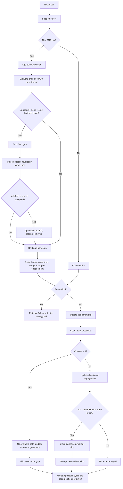

# Ticks and Zones to Signals

This document covers the EA’s market-to-signal decisions. It starts with the chart’s M15 market context and ends at a reversal or breakout signal, or at the creation/update of a pullback opportunity. The next stage is documented in [Signals to Orders](SIGNALs_to_ORDERS.md); post-submission behavior is in [Order and Position Management](ORDER_and_POSITION_management.md).

The source of truth is `mt5/MQL5/Experts/XAUUSD_ROBUST_FINAL_LIVE_RCv2.mq5`.

## Purpose and scope

The EA evaluates the current Bid against the active broker-day zones and a trend state derived from the last three closed M15 candles. It can identify reversal touches and confirmed buffered breakouts. A breakout can also seed a pullback cycle; the later pullback penetration is a deferred entry condition, not a new market-to-signal calculation.

## Tick-to-signal decision flow

On each tick, the EA obtains a native `MqlTick`, runs session safety, processes a newly opened M15 bar if necessary, and stops strategy evaluation under the same-day restart lock. Otherwise it updates trend from Bid, evaluates zone crossings using current and previous Bid, updates zone engagement, processes eligible reversal touches, advances pullback cycles, manages open-position protection, and stores Bid for the next tick. On a new bar, it first ages existing pullback cycles, evaluates the just-closed bar against the saved trend snapshot, changes broker-day zones if needed, then refreshes the reference range and bar-open zone engagement.

## Market data and trading context

- The EA requires the M15 chart period. At startup it requires at least four M15 bars: the current bar and three closed reference bars.
- `UpdateTrendReference` takes the high maximum and low minimum across the three closed M15 bars (`CopyRates(..., PERIOD_M15, 1, 3, ...)`). A failed copy leaves no refreshed reference; initialization fails if the initial refresh fails.
- `UpdateTrendState` sets `TREND_UP` only when Bid is strictly above the reference high and `TREND_DOWN` only when Bid is strictly below the reference low. Inside or on either boundary, the previous trend persists. Thus an intrabar transition from up to down (or vice versa) is possible when Bid crosses the opposite reference boundary.
- This is a rolling range-break state, not a candle-pattern or slope test: the three bars contribute only their highest high and lowest low; their bullish/bearish classes, order, and closes do not determine trend. After a new M15 bar is detected, the just-closed bar is evaluated with the existing trend snapshot first; then the reference range is refreshed from shifts 1..3, and the current tick's Bid may update trend against that new range.
- Candle class is descriptive only: close above open is bullish, below open bearish, equal is doji. The signal conditions use the actual close, trend snapshot, zone engagement, and configured buffer; candle class is not an additional filter.
- Broker day is derived from server time. Day change loads that day’s zones and resets daily realized counters, daily stop, sequence and some per-day context; it does not close already-open positions merely because the date changed.

## Zone identification, evaluation, and lifecycle

The EA reads enabled zone rows for the exact broker-day date. A zone requires a valid date, `high` or `normal` priority, and positive bounds; bounds are normalized low-to-high. Disabled rows are skipped. Valid zones are sorted by low, assigned IDs (`R1`, `R2`, etc.), then merged left-to-right whenever the next low minus the accumulated high is strictly less than `$1.50`. The merged bounds expand to the min/max, constituent IDs concatenate, and any high-priority member makes the merged zone high priority. Equality at a `$1.50` gap does not merge.

Each day’s zone runtime state starts with buy/sell engagement false, reversal usage unused, and fill counters zero. At a new M15 bar, a zone containing the bar open (`low <= open <= high`) starts engaged for both directions. During a normal tick, crossing upward through a zone’s low engages its buy side; crossing downward through its high engages its sell side. Engagement persists for the rest of that bar. On a tick that crosses more than one zone directionally, the EA does not infer an intratick path: any zone containing the final Bid is marked engaged both ways, and no reversal touch is processed on that tick.

Zones are rebuilt on broker-day change, not continuously adjusted. Missing current-day zones make `g_day_valid` false and suppress zone-based signals. The zone loader’s file source is outside this document’s decision focus; its validated behavior is summarized here only because it defines which price bands can participate.

## Tick and price evaluation

Zone crossing tests compare consecutive Bid observations, with strict outside-to-boundary-inclusive transitions:

- Upward crossing: `previous_bid < zone.low && bid >= zone.low`.
- Downward crossing: `previous_bid > zone.high && bid <= zone.high`.
- Multi-zone gap: more than one such directional crossing in a single observed tick. It emits no synthetic crossing path and suppresses reversal processing for that tick.

Reversal direction is counter to the active trend: an upward zone-low crossing while trend is up is `R-S`; a downward zone-high crossing while trend is down is `R-B`. Closed-bar breakouts instead require a close beyond the engaged zone edge plus `InpBreakoutBufferUSD` (default `$1.00`) and trend in the breakout direction.

## Signal-generation rules and conditions

### Reversal touch

`ProcessDirectionalReversalTouches` requires valid daily zones, no daily stop, and no multi-zone gap. It scans zones in sorted order. For each zone, an uptrend plus upward crossing of the zone low proposes `R-S`; a downtrend plus downward crossing of the zone high proposes `R-B`. The rule slot is claimed before `SendReversal` applies entry eligibility. Only one signal attempt per M15 bar, zone, and direction is allowed; repeated same-direction recrosses are suppressed. The opposite direction has its own slot, so a genuine intrabar trend reversal can produce the opposite-direction attempt within the same bar.

The touch confirmation (`ZONE_TOUCH_DIRECTION_CONFIRMED`) is a candidate event. The formal `REVERSAL_SIGNAL` event is written later, only after reversal eligibility, quota, risk, and candle-slot checks pass; order submission can still fail after that point. A blocked touch therefore need not become a formal signal or order.

### Breakout

`ProcessClosedBar` evaluates the just-closed candle using the trend snapshot captured before the reference range rolls forward. A buy breakout requires buy-side engagement, `trend_at_close == TREND_UP`, and `close > zone.high + buffer`. A sell breakout requires sell-side engagement, `trend_at_close == TREND_DOWN`, and `close < zone.low - buffer`. The comparison is strict. A qualifying breakout receives a sequential broker-day ID and is recorded as `BO-B` or `BO-S`.

The breakout first invalidates active reversal positions in the same zone with the opposite position direction. If any such close request fails, processing of that zone’s direct breakout and pullback creation stops for this bar. Otherwise, the optional direct-breakout order path is attempted when enabled, and a pullback cycle is created when pullbacks are enabled and daily stop is still clear. The selected default has direct breakout disabled and pullback enabled.

### Deferred pullback opportunity

A valid breakout may create one active cycle per broker day, zone and direction. An existing active same-key cycle is left unchanged; it is not restarted by a repeated breakout. The cycle stores the broken zone bounds and breakout-bar time and begins at valid bar number 1. Its entry condition is observed later by `ManagePullbackCycles`: buy pullback penetration latches when `Bid <= zone_high - InpPullbackPenetrationUSD`; sell penetration latches when `Bid >= zone_low + InpPullbackPenetrationUSD` (default `$0.20`). There is no maximum penetration-distance check. Penetration only latches the condition; order eligibility and placement are covered in [Signals to Orders](SIGNALs_to_ORDERS.md).

### How the three-bar trend affects reversals and pullbacks

| Path | Trend's role | What trend does not do |
|---|---|---|
| Reversal touch | The current tick updates trend first. In `TREND_UP`, only an upward crossing of a zone's low proposes countertrend `R-S`; in `TREND_DOWN`, only a downward crossing of a zone's high proposes countertrend `R-B`. The same crossing in the other trend state does not propose that reversal. | Trend alone is insufficient: zone crossing, one-attempt slot, daily/session/restart gates, profile/quota, risk, and order checks still apply. A trend change can enable the opposite reversal direction later in the same M15 bar because each direction has its own slot. |
| Breakout that can seed pullback | At the close decision, the saved trend snapshot must agree with breakout direction: up for buy, down for sell, alongside zone engagement and strict buffered close. A qualifying breakout may create a pullback cycle. | Candle color is not a filter, and current Bid crossing the three-bar range does not itself create a pullback. |
| Existing pullback cycle | Trend confirmation was applied to its originating breakout. Later, `ManagePullbackCycles` checks cycle/day validity, session and daily stop, `MVPPullbackAllowed`, and the directional zone-edge penetration latch. | It does not re-check that current trend still agrees with the cycle direction. A trend flip alone does not invalidate or cancel the cycle. |

In short, the three-bar range directly selects the eligible countertrend reversal side and direction-filters breakout creation. For pullbacks it is an upstream breakout filter only; the later pullback-entry condition is price penetration plus cycle and entry eligibility. The trend is persistent inside the range, so a previously set trend remains in force until Bid strictly breaks the opposite boundary (or the current boundary is broken again in its direction).

## Filters, confirmations, and invalidation rules

- Missing/invalid active zones and unavailable native ticks prevent zone decisions; failed initial trend-reference setup prevents initialization. Restart lock is checked after new-bar processing, so a closed-bar breakout event may still be emitted, but all entry paths are blocked. Daily stop suppresses reversal attempts and pullback creation/management, but closed-bar breakout detection/event recording still runs; direct breakout submission is separately rejected by its entry guard.
- Multi-zone tick gaps suppress reversals and do not create synthetic breakouts; the EA still updates engagement for zones containing the observed Bid.
- Reversal de-duplication is per M15 bar + zone + direction, not a permanent consumed-signal ID. The slot is claimed before downstream order eligibility, so a blocked first touch is not retried on another same-direction touch that bar.
- A breakout’s opposite-direction reversal invalidation has precedence over direct breakout submission and pullback cycle creation. A close failure prevents those latter actions for that zone on that closed-bar evaluation.
- Active same-key pullback cycles are not restarted. Cycles expire as they age through the configured window, can be canceled by daily stop, session safety, restart/emergency handling, or failed eligibility at management time, and are closed when their native order fills.
- Current trend is persistent between reference-range breaches. Zone engagement is also persistent within the bar after open-inside or directional cross.

## State-dependent decisions and rule interactions

`g_prev_bid`, `g_trend`, `g_ref_high/low`, `g_bar_time`, `g_day_valid`, and each zone’s engagement flags determine signal transitions directly. Zone priority, pullback/reversal fill counts, configuration gates, and session/daily/restart locks influence whether the candidate can proceed into the order-decision stage. The fill counters advance on recognized fills, not on signal detection. `reversal_usage` is bookkeeping for the visible accounting lifecycle and does not itself gate the documented touch rule; reversal quota is enforced from `reversal_fill_count` in the order path.

Within a tick the implemented order is: session safety → bar transition and closed-bar breakout decision → restart lock check → trend update → crossing count/engagement → reversal touch attempts → pullback-cycle management → profit protection. This means a bar transition can process the prior bar’s breakout before the current tick updates trend, and a reversal touch uses the trend after that current-tick update.

## Decision tables and meaningful edge cases

| Observed condition | Signal/state requirement | Decision | Result |
|---|---|---|---|
| Bid crosses zone low upward | Current trend is up; slot unused for bar/zone/sell | Propose `R-S` | Reversal attempt; downstream gates can still block it |
| Bid crosses zone high downward | Current trend is down; slot unused for bar/zone/buy | Propose `R-B` | Reversal attempt; downstream gates can still block it |
| More than one directional zone crossing in one tick | Any trend | Do not infer path or process reversal | Engagement only for zones containing final Bid |
| Closed bar closes above zone high + buffer | Buy engaged and trend snapshot up | Emit `BO-B` | Then opposite reversal close; optional direct order; optional PB cycle |
| Closed bar closes below zone low - buffer | Sell engaged and trend snapshot down | Emit `BO-S` | Then opposite reversal close; optional direct order; optional PB cycle |
| Close equals buffered threshold | Any | Strict breakout comparison fails | No breakout |
| Reversal close requested by breakout fails | Opposite reversal exists | Stop processing that zone’s later breakout actions | No direct BO request or PB cycle on that evaluation |
| Same-key pullback cycle already active | Repeated valid breakout | Keep existing cycle | No duplicate cycle/restart |

## Trading decision flowchart

## Source-code reference map

| Decision | Implementation |
|---|---|
| Tick and new-bar ordering | `XAUUSD_ROBUST_FINAL_LIVE_RCv2.mq5`: `ApprovedStrategyOnTick` (3615), `ProcessNewBar` (3466), `HandleDayChange` (3448) |
| Zone validation, sorting, merge and daily runtime state | `LoadAllRawZones` (1237), `NormalizeZone` (1202), `SortZones` (1298), `MergeZones` (1312), `LoadZonesForDay` (1412) |
| Trend and zone engagement | `UpdateTrendReference` (1473), `UpdateTrendState` (1492), `ResetEngagementForCurrentBar` (1504), `CountDirectionalZoneCrosses` (1516), `UpdateZoneEngagement` (1529) |
| Reversal touch direction and de-duplication | `ClaimReversalSignalSlot` (2365), `ProcessDirectionalReversalTouches` (2650) |
| Breakout and opposite-reversal invalidation | `ProcessClosedBar` (3003), `CloseAllInvalidatedReversals` (2922), `CloseInvalidatedReversal` (2936) |
| Pullback cycle signal and penetration latch | `CreatePullbackCycle` (2691), `ManagePullbackCycles` (2860), `AgePullbackCyclesOnNewBar` (2743) |
| Live release / restart gate affecting tick decisions | `XauRobustLiveEnvelope.mqh`: `XauReleaseRuntimeGuard` (171), `OnTick` (293); strategy `DetectSameDayRestartFailClosed` (1951) |

## Unresolved questions and verification gaps

- The source calculates zone prices and thresholds in raw price units and normalizes order prices later; it does not encode a separate pip/tick-size conversion for the `$1.50`, `$1.00`, or `$0.20` strategy distances.
- Signals and trading actions share methods rather than a durable signal object/queue. The documented “signal” is the condition/event at the decision point, not a guarantee that an order is submitted.
- Actual tick sequencing, bar history, session schedule, and broker-side execution outcomes depend on the terminal, symbol feed, and broker. The code alone does not establish that observed market data or fills match a particular test or live run.
